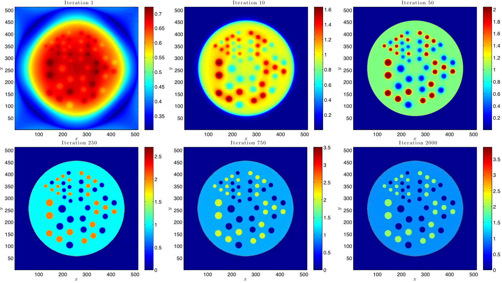
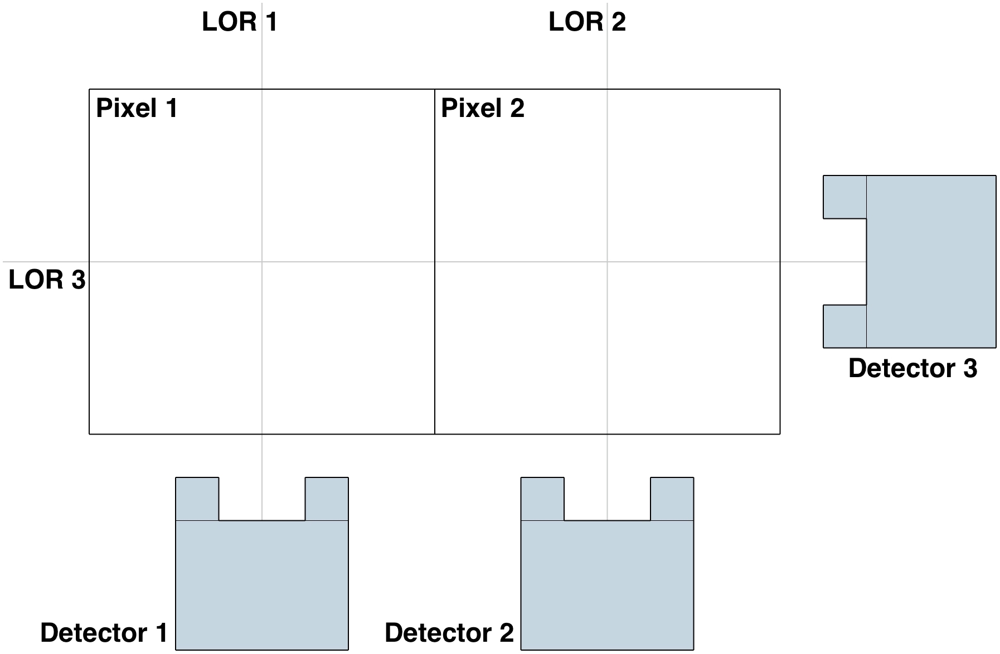
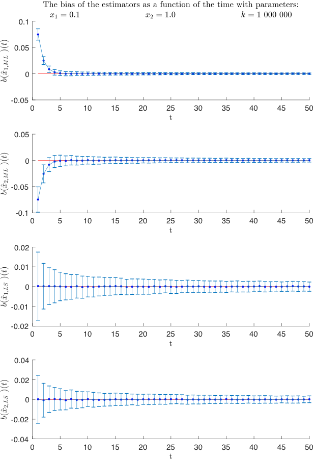
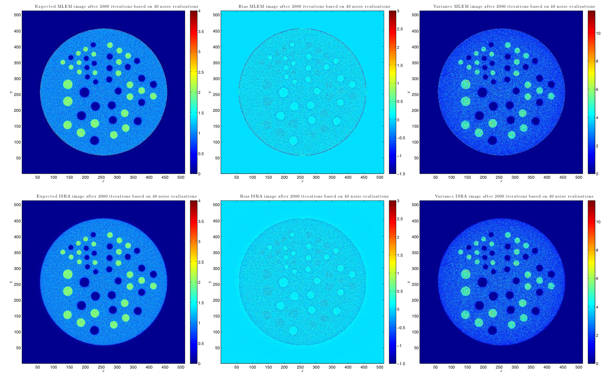

# VUB PET reconstruction (MLEM vs. ISRA)

*Statistical image reconstruction: an analysis of the trade-off between bias and variance in PET scans* was my master thesis in Physics and Astronomy at the Vrije Universiteit Brussel (VUB), done in the Department of Nuclear Medicine and submitted in June 2018. It compares two iterative algorithms that reconstruct a PET scan from its raw detector data. The simulations and figures are in MATLAB, and the thesis is written in LaTeX.

The thesis itself is [thesis/thesis.pdf](thesis/thesis.pdf), and a one-page summary is [thesis/abstract.pdf](thesis/abstract.pdf).

## What it does

A PET scanner counts pairs of photons along lines of response (LORs) through the patient, and the image has to be estimated from those counts. Iterative statistical methods replaced analytical ones such as filtered backprojection as computers grew more powerful. The two algorithms compared here differ in what they assume about the data:

- **MLEM** (maximum likelihood, expectation maximisation; Shepp and Vardi, 1982) assumes Poisson-distributed counts. It is still the default in PET.
- **ISRA** (image space reconstruction algorithm; Daube-Witherspoon and Muehllehner, 1986) assumes Gaussian-distributed counts and converges to a non-negative least-squares estimate. It was designed for full 3D PET: it backprojects the data once, which saves memory and work per iteration. It has been studied much less than MLEM.

The question is whether the Gaussian assumption costs anything in image quality. The thesis answers it in three steps:

- **Theory.** It derives maximum likelihood and least-squares estimators, shows that the Gaussian maximum likelihood estimator is the least-squares estimator, and derives both iterative algorithms.
- **A toy problem.** On 2 pixels seen by 3 detectors, it finds closed-form expressions for the expected value, bias and variance of both estimators, checks them with Monte Carlo simulations, and shows that MLEM and ISRA converge to them.
- **A realistic image.** It reconstructs simulated data of a 512 × 512 Jaszczak phantom (25 hot regions, 23 cold regions, uniform background) with both algorithms. It compares their rate of convergence, time per iteration, and expected value, bias and variance over 40 noise realisations, per region of interest.

| The toy problem | Bias of the estimators vs. acquisition time |
|---|---|
|  |  |

The result: the two algorithms take a comparable time per iteration and give nearly the same images. The one measurable difference is at the outer edge of the phantom, where ISRA has a larger bias than MLEM at a comparable variance. For 2D reconstruction they can be considered equivalent for all practical purposes. The thesis ends with what would be needed to confirm this: more phantoms, more noise realisations, different count levels, and 3D.

## How it works

The code in `code/` is MATLAB:

- `MLEM.m` and `ISRA.m` are the two algorithms as functions of an initial image, the data, the system matrix and the number of iterations. They are written out as plain loops, for the toy problem.
- `ToySimulation.m` computes the closed-form expected value and variance of the estimators of the toy problem as a function of acquisition time, and checks them against Monte Carlo simulations with Poisson noise.
- `ToyReconstructionMLEM.m` and `ISRABias.m` run the iterative algorithms on the toy problem and compare them with the analytical estimators.
- `makeImages.m` makes the figures of the Jaszczak study: convergence, difference images between iterations, and the sample, expectation, bias and variance images over 40 noise realisations.
- `FancyFigures.m` draws the probability distributions in the introduction (normal, binomial, and the normal approximation of the binomial).

| Path | What it is |
|---|---|
| `thesis/thesis.pdf` | The thesis as submitted |
| `thesis/abstract.pdf` | One-page summary |
| `thesis/thesis.tex`, `thesis/figures/`, `thesis/vubtitlepage.sty`, `thesis/Makefile` | Its LaTeX source |
| `code/` | The MATLAB code |
| `docs/images/` | The images in this README |

## Running it

The code needs MATLAB with the Statistics and Machine Learning Toolbox (for `poissrnd`). The toy problem scripts are self-contained: run them from `code/`. `makeImages.m` reads reconstructions of the Jaszczak phantom from `code/temp/`, which came from a PET simulator and reconstruction software that are not part of this repository.

To build the thesis, run `make` in `thesis/`. It runs `pdflatex` three times.

## License

BSD 3-Clause, see [LICENSE](LICENSE). The license covers the code in `code/`. The thesis text is © 2018 Jeremy Lombaerts. Figures taken from other sources are credited in the thesis and are not covered by this license.
